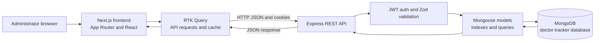

# Doctor Tracker

Doctor Tracker is a web-based administration portal for managing doctors and their patient records. Administrators can search, filter, and paginate records, review patients assigned to each doctor, and use a dashboard to understand patient counts and trends.

> **Project status:** The repository contains a Next.js frontend and a separate Express API backed by MongoDB. The current API supports admin login and management workflows described below. The patient-list endpoint is currently public; see [Security notes](#security-notes).

## Features

- Admin login, logout, current-user lookup, and refresh-token endpoint.
- Doctor creation, listing, search, filtering, pagination, detail view, update, and deletion.
- Patient listing, search, condition and date filtering, pagination, update, and deletion.
- Add patients to a doctor and view or remove a doctor's patients.
- Dashboard totals, patient counts per doctor, monthly patient trend, condition breakdown, and five most recently added patients.
- Responsive admin interface with light/dark theme support.
- Request validation, consistent JSON responses, MongoDB text-search indexes, and database-level filtering and pagination.

## Technology stack

| Area | Technologies |
| --- | --- |
| Frontend | Next.js App Router, React, TypeScript, Tailwind CSS |
| Client state and API requests | Redux Toolkit and RTK Query |
| Charts and icons | Recharts and Lucide |
| Backend | Node.js, Express |
| Database and models | MongoDB, Mongoose |
| Authentication | JWT, bcrypt, HTTP-only cookies |
| Request validation | Zod |

## Project structure

```text
Doctor-Tracker/
├── client/
│   ├── app/                   # App Router routes and layouts
│   ├── components/            # Shared layouts, providers, and UI
│   ├── lib/
│   │   ├── api.ts             # RTK Query API and endpoints
│   │   └── store.ts           # Redux store configuration
│   └── package.json
├── server/
│   ├── src/
│   │   ├── config/            # MongoDB connection
│   │   ├── controllers/       # Route handlers
│   │   ├── middlewares/       # Authentication and validation
│   │   ├── models/            # Mongoose schemas and indexes
│   │   ├── routes/            # Express route definitions
│   │   ├── scripts/           # Admin seeding script
│   │   ├── utils/             # API responses, dates, pagination
│   │   └── validation/        # Zod schemas
│   └── package.json
├── readme.md
└── .gitignore
```

## Prerequisites

- Node.js 20 or newer and npm.
- MongoDB, either a local instance or a MongoDB Atlas connection string.
- A modern browser.

## Local setup

### 1. Configure the backend

```bash
cd server
npm install
```

Copy `server/.env.example` to `server/.env` and set values for your environment. In particular, use a reachable MongoDB URI and replace all example secrets and admin credentials. The server connects to the configured MongoDB deployment and uses a database named `doctor-tracker`.

```bash
# macOS / Linux
cp .env.example .env

# Windows PowerShell
Copy-Item .env.example .env
```

Create the initial admin user, then start the API:

```bash
npm run seed
npm run dev
```

The seed command is safe to rerun: it reports when the configured admin email already exists. The API listens on `http://localhost:5000` by default.

### 2. Configure the frontend

In a second terminal:

```bash
cd client
npm install
```

Copy `client/.env.example` to `client/.env.local`. Set `NEXT_PUBLIC_API_BASE_URL` to the running backend URL. The example uses the backend's default port:

```bash
# macOS / Linux
cp .env.example .env.local

# Windows PowerShell
Copy-Item .env.example .env.local
```

Start the frontend:

```bash
npm run dev
```

Open `http://localhost:3000`. The API CORS configuration allows `http://localhost:3000` and `http://localhost:3001`; if using another frontend origin, add it to the server's comma-separated `CORS_ORIGIN`.

### Environment variables

#### Backend (`server/.env`)

| Variable | Purpose | Example |
| --- | --- | --- |
| `PORT` | Express listening port | `5000` |
| `CORS_ORIGIN` | Allowed frontend origins, comma-separated | `http://localhost:3000,http://localhost:3001` |
| `MONGODB_URI` | MongoDB connection URI, without a database path if using the default database selection | `mongodb://127.0.0.1:27017` |
| `ACCESS_TOKEN_SECRET` | Secret used to sign access JWTs | Generate a private random value |
| `ACCESS_TOKEN_EXPIRY` | Access-token lifetime | `15m` |
| `REFRESH_TOKEN_SECRET` | Secret used to sign refresh JWTs | Generate a different private random value |
| `REFRESH_TOKEN_EXPIRY` | Refresh-token lifetime | `7d` |
| `ADMIN_NAME` | Name for the seeded administrator | `Admin` |
| `ADMIN_EMAIL` | Email for the seeded administrator | `admin@example.com` |
| `ADMIN_PASSWORD` | Password for the seeded administrator | Set a strong, unique value |

#### Frontend (`client/.env.local`)

| Variable | Purpose | Example |
| --- | --- | --- |
| `NEXT_PUBLIC_API_BASE_URL` | Base URL for the Express API | `http://localhost:5000/api/v1` |

Only put public configuration in variables prefixed with `NEXT_PUBLIC_`; those values are embedded into frontend JavaScript. Never put secrets there.

## Live demo

- **Frontend:** [Add the deployed frontend URL here](#)
- **Backend API:** [Add the deployed API base URL here, including `/api/v1`](#)
- **Demo email:** `admin@example.com`
- **Demo password:** Shared privately with the recruiter; it is intentionally not published in this README.

Replace both URL placeholders after deployment. The backend URL should point to the API base, for example `https://api.example.com/api/v1`, not just the hosting dashboard or server root.

## System architecture and data flow



The frontend and API run as separate services. The browser calls the Express API at `NEXT_PUBLIC_API_BASE_URL`; the API validates input, checks authentication where configured, performs Mongoose queries, and returns JSON responses. The browser includes cookies on API requests. Doctor and patient list pagination, search, and filters are applied by the API and MongoDB rather than only in the browser.

## API overview

All routes are prefixed with `/api/v1`. For local development, the base URL is `http://localhost:5000/api/v1`.

| Method | Endpoint | Authentication | Description |
| --- | --- | --- | --- |
| `POST` | `/auth/login` | Public | Authenticate with email and password |
| `POST` | `/auth/refresh` | Refresh token | Rotate the refresh token and issue new tokens |
| `POST` | `/auth/logout` | Access token | Log out and clear the refresh token |
| `GET` | `/auth/me` | Access token | Return the current user |
| `GET` | `/doctors` | Access token | List doctors; supports `search`, `specialization`, `hospital`, `from`, `to`, `page`, `limit` |
| `POST` | `/doctors` | Access token | Create a doctor |
| `GET` | `/doctors/:id` | Access token | Get doctor details |
| `PUT` | `/doctors/:id` | Access token | Update doctor details |
| `DELETE` | `/doctors/:id` | Access token | Delete a doctor and their patient records |
| `GET` | `/doctors/:doctorId/patients` | Access token | List the doctor's patients; supports search, condition, dates, and pagination |
| `POST` | `/doctors/:doctorId/patients` | Access token | Add a patient under the doctor |
| `GET` | `/patients` | **Public currently** | List patients; supports `search`, `condition`, `doctor`, `from`, `to`, `page`, `limit` |
| `PUT` | `/patients/:id` | Access token | Update a patient |
| `DELETE` | `/patients/:id` | Access token | Delete a patient |
| `GET` | `/dashboard/stats` | Access token | Get dashboard totals, charts, and recent patients; supports `months` and `top` |

List endpoints use `page` (default `1`) and `limit` (default `10`, maximum `100`). Responses use a common envelope containing `statusCode`, `success`, `data`, and `message`; list results include pagination metadata.

## Technical decisions

### 1. Separate Express API from the Next.js frontend

The frontend is a Next.js App Router application, while Express runs as its own server. This keeps UI routing/rendering separate from API concerns such as authentication, validation, and persistence. The separation also allows the API and web application to be deployed and scaled independently. The trade-off is that local and production environments must configure the API URL and CORS origins consistently.

### 2. RTK Query for API data and cache invalidation

API endpoints and request caching are centralized in `client/lib/api.ts`, while Redux store configuration lives in `client/lib/store.ts`. RTK Query provides generated hooks and invalidation tags so doctor or patient mutations can refresh related cached data, including dashboard data. This avoids duplicating request/loading/cache logic across pages. The trade-off is that endpoint response types and tag invalidation rules must stay aligned with the Express API.

## Visual evidence

Replace the placeholder image paths below with screenshots captured from the running app. Keep the screenshots in `docs/images/` (or update the paths if you store them elsewhere). Capture both desktop and mobile layouts.

### Dashboard


### Doctor management


### Patient management


### Login


## Validation and production build

Run the frontend checks from `client/`:

```bash
npx tsc --noEmit
npm run lint
npm run build
```

The frontend package does not currently define an automated test script. Exercise the login, doctor, patient, filtering, pagination, and dashboard flows against a non-production database before deploying.

At the time of writing, the TypeScript check and production build pass. ESLint reports existing issues, primarily `any` types and React/JSX lint rules; resolve those before using lint as a passing CI gate.

## Security notes

- Do not commit `server/.env`, `client/.env`, or `client/.env.local`. The checked-in `.env.example` files contain placeholders only.
- Replace sample JWT secrets and admin credentials before running the seed script or deploying.
- The API currently leaves `GET /api/v1/patients` public; add authentication if patient data must be restricted.
- Although the API has a refresh-token endpoint, the frontend does not currently retry failed requests after refreshing an expired access token. Users may need to sign in again when the access token expires.
- Client-side route redirects are for user experience, not authorization. Keep access control enforced in API middleware.
- The API sets authentication cookies as HTTP-only and secure. Configure HTTPS and matching CORS origins for deployment.