# Doctor Tracker

## Description

Doctor Tracker is a responsive administrative portal for managing doctors and their patient records, with searchable and filterable lists, doctor-specific patient workflows, and a dashboard that turns healthcare records into useful counts and trends. Administrators can securely sign in, manage records, and review visual summaries from desktop or mobile.

### Core features

- Admin login, logout, current-user lookup, and refresh-token endpoint.
- Doctor creation, listing, search, filtering, pagination, detail view, update, and deletion.
- Patient listing, search, condition and date filtering, pagination, update, and deletion.
- Add patients to a doctor and view or remove a doctor's patients.
- Dashboard totals, patients per doctor, monthly patient trends, condition breakdown, and recent patients.
- Responsive admin interface with light/dark theme support.
- Request validation and database-level filtering, pagination, and text-search indexes.

### Technology stack

| Area | Technologies |
| --- | --- |
| Frontend | Next.js App Router, React, TypeScript, Tailwind CSS |
| Client state and API requests | Redux Toolkit and RTK Query |
| Charts and icons | Recharts and Lucide |
| Backend | Node.js, Express |
| Database and models | MongoDB, Mongoose |
| Authentication | JWT, bcrypt, HTTP-only cookies |
| Request validation | Zod |

### Repository structure

```text
Doctor-Tracker/
├── client/
│   ├── app/                   # App Router routes and layouts
│   ├── components/            # Shared layouts, providers, and UI
│   ├── lib/
│   │   ├── api.ts             # RTK Query API and endpoints
│   │   └── store.ts           # Redux store configuration
│   ├── .env.example           # Frontend environment template
│   └── package.json
├── server/
│   ├── src/
│   │   ├── config/            # MongoDB connection
│   │   ├── controllers/       # Route handlers
│   │   ├── middlewares/       # Authentication and validation
│   │   ├── models/            # Mongoose schemas and indexes
│   │   ├── routes/            # Express route definitions
│   │   ├── scripts/           # Admin seeding script
│   │   └── validation/        # Zod schemas
│   ├── .env.example           # Backend environment template
│   └── package.json
├── docs/                      # Desktop and mobile screenshots
└── readme.md
```

### Project links

- **Deployed frontend:** [Doctor Tracker](https://doctor-tracker-peach.vercel.app/)
- **Backend API:** [API v1](https://doctor-tracker-oj9m.onrender.com/api/v1)
- **GitHub repository:** [md-abunayem/doctor-tracker](https://github.com/md-abunayem/doctor-tracker)
- Demo credentials are not published in this repository; request them from the project owner if needed.

## Setup Guide

### Prerequisites

- Node.js 20 or newer and npm.
- MongoDB, either a local instance or a MongoDB Atlas connection string.
- A modern browser.

### 1. Configure the backend

From the repository root, install the backend dependencies:

```bash
cd server
npm install
```

Copy `server/.env.example` to `server/.env` and configure the database URI, unique JWT secrets, and administrator credentials. The example uses a local MongoDB instance; the API connects to the `doctor-tracker` database. Do not commit `.env` files or use the example secrets in production.

```powershell
Copy-Item .env.example .env
```

Create the initial admin user, then start the API:

```bash
npm run seed
npm run dev
```

The API listens on `http://localhost:5000` by default. The seed command reports if the configured admin email already exists.

### 2. Configure the frontend

Open a second terminal at the repository root, install frontend dependencies, and copy its environment template:

```bash
cd client
npm install
```

```powershell
Copy-Item .env.example .env.local
```

The default `NEXT_PUBLIC_API_BASE_URL` in the example is `http://localhost:5000`. It must be the backend origin, without an `/api/v1` suffix. Next.js proxies `/api/*` requests to this origin.

Start the frontend:

```bash
npm run dev
```

Open `http://localhost:3000` and sign in with the admin account configured in `server/.env`.

### Environment variables

#### Backend (`server/.env`)

| Variable | Purpose | Example |
| --- | --- | --- |
| `PORT` | Express listening port | `5000` |
| `CORS_ORIGIN` | Allowed frontend origins, comma-separated | `http://localhost:3000,http://localhost:3001` |
| `MONGODB_URI` | MongoDB connection URI | `mongodb://127.0.0.1:27017` |
| `ACCESS_TOKEN_SECRET` | Secret used to sign access JWTs | Generate a private random value |
| `ACCESS_TOKEN_EXPIRY` | Access-token lifetime | `15m` |
| `REFRESH_TOKEN_SECRET` | Secret used to sign refresh JWTs | Generate a different private random value |
| `REFRESH_TOKEN_EXPIRY` | Refresh-token lifetime | `7d` |
| `ADMIN_NAME` | Name for the seeded administrator | `Admin` |
| `ADMIN_EMAIL` | Email for the seeded administrator | `admin@example.com` |
| `ADMIN_PASSWORD` | Password for the seeded administrator | Set a strong, unique value |

#### Frontend (`client/.env.local`)

| Variable | Purpose | Example |
| --- | --- | --- |
| `NEXT_PUBLIC_API_BASE_URL` | Express server origin used by the Next.js API proxy | `http://localhost:5000` |

Only put public configuration in variables prefixed with `NEXT_PUBLIC_`; those values may be embedded into frontend JavaScript. Never put secrets there.

### Production deployment configuration

- In Vercel, set `NEXT_PUBLIC_API_BASE_URL` to `https://doctor-tracker-oj9m.onrender.com` (no `/api/v1` suffix), then redeploy.
- In Render, configure `CORS_ORIGIN` with the exact frontend origin, such as `https://doctor-tracker-peach.vercel.app`, and configure the production MongoDB URI, JWT secrets, and admin credentials.
- Use HTTPS for both deployed services. The frontend sends API requests to its own `/api/v1` path, and Next.js proxies them to the backend.

## System Architecture

The browser renders the Next.js application and uses RTK Query for client-side API calls and caching. Those requests go to the same-origin `/api/v1` path, which Next.js rewrites to the standalone Express API. Express validates requests, checks JWT authentication on protected routes, and uses Mongoose to query MongoDB. Authentication cookies are HTTP-only, secure, and configured for the deployed HTTPS setup.

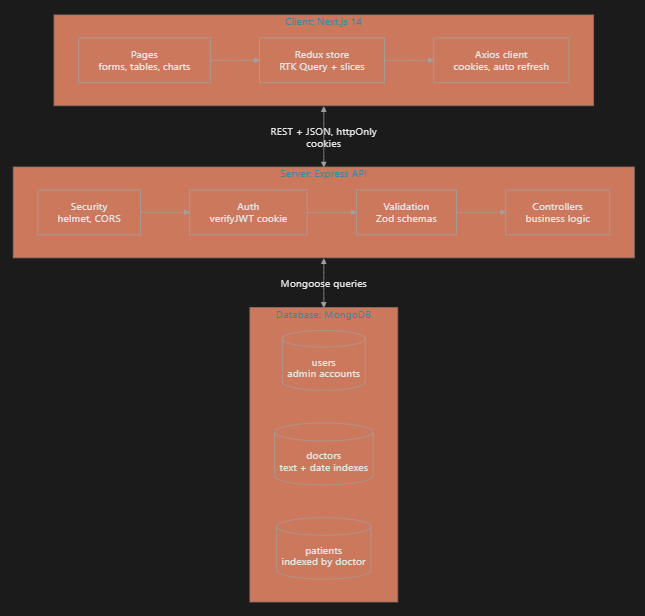

### API overview

All API routes are prefixed with `/api/v1`. For local development, the backend base URL is `http://localhost:5000/api/v1`.

| Method | Endpoint | Authentication | Description |
| --- | --- | --- | --- |
| `POST` | `/auth/login` | Public | Authenticate with email and password |
| `POST` | `/auth/refresh` | Refresh token | Rotate the refresh token and issue new tokens |
| `POST` | `/auth/logout` | Access token | Log out and clear authentication cookies |
| `GET` | `/auth/me` | Access token | Return the current user |
| `GET` | `/doctors` | Access token | List doctors; supports search, specialization, hospital, dates, and pagination |
| `POST` | `/doctors` | Access token | Create a doctor |
| `GET` | `/doctors/:id` | Access token | Get doctor details |
| `PUT` | `/doctors/:id` | Access token | Update doctor details |
| `DELETE` | `/doctors/:id` | Access token | Delete a doctor and their patient records |
| `GET` | `/doctors/:doctorId/patients` | Access token | List a doctor's patients |
| `POST` | `/doctors/:doctorId/patients` | Access token | Add a patient under a doctor |
| `GET` | `/patients` | **Public in current implementation** | List patients; supports search, condition, doctor, dates, and pagination |
| `PUT` | `/patients/:id` | Access token | Update a patient |
| `DELETE` | `/patients/:id` | Access token | Delete a patient |
| `GET` | `/dashboard/stats` | Access token | Get dashboard totals, charts, and recent patients |

List endpoints use `page` (default `1`) and `limit` (default `10`, maximum `100`). Responses use a common envelope containing `statusCode`, `success`, `data`, and `message`; list results include pagination metadata.

> **Authentication gap:** The task specification requires authenticated access to the portal, but `GET /api/v1/patients` is currently public. Protect this endpoint before using real or sensitive patient data.

## Technical Decisions

### 1. Keep the Express API as a standalone service

The frontend and API are separate deployable services: Next.js owns the user interface and same-origin API proxy, while Express owns REST endpoints, validation, authentication, and database access. Keeping those responsibilities separate lets the API serve the application independently of frontend rendering and makes the backend boundary explicit. The trade-off is that local and production environments must configure the API origin and deployment settings consistently.

### 2. Use RTK Query for client-side API state

RTK Query centralizes endpoint definitions, request state, caching, and invalidation in `client/lib/api.ts`; the Redux store is configured in `client/lib/store.ts`. Mutations invalidate related doctor, patient, dashboard, or authentication tags so active views can refresh without each page implementing its own request lifecycle. Compared with using React Context or hand-written fetch state, RTK Query provides cache behavior and request deduplication that fit these data-heavy screens. The trade-off is that endpoint response types and invalidation tags must stay aligned with the API.

## Visual Evidence

Screenshots show the desktop and mobile layouts for the dashboard, doctor list and details, patient management, and admin login.

### Desktop

#### Dashboard

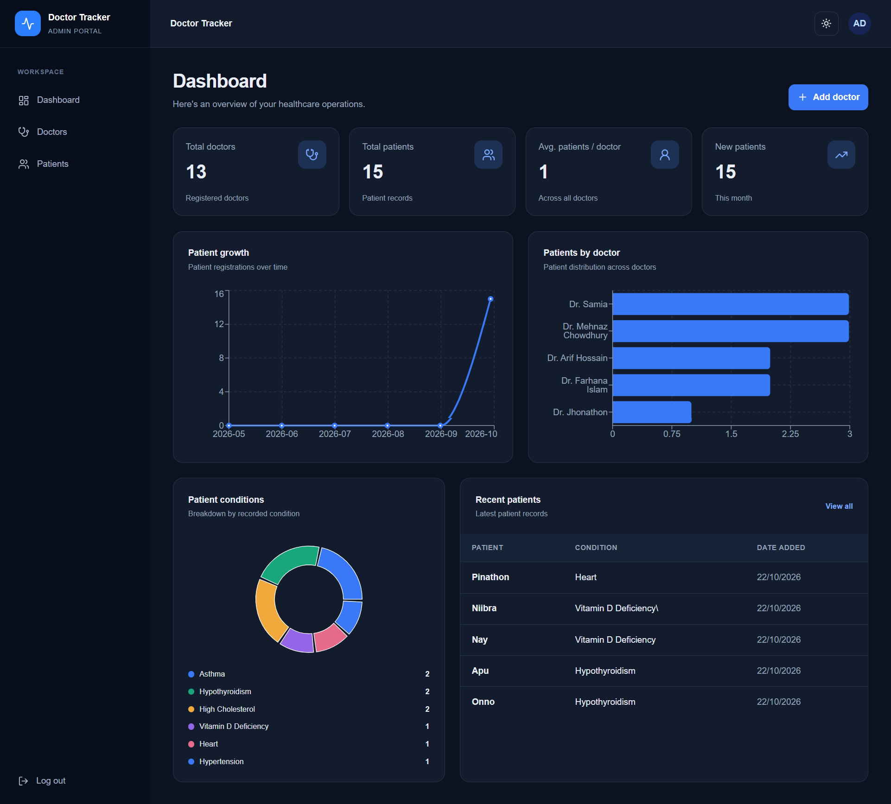

#### Doctor management

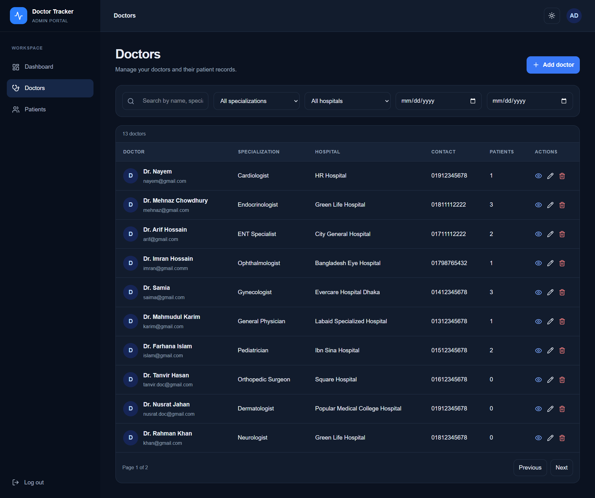

#### Doctor details

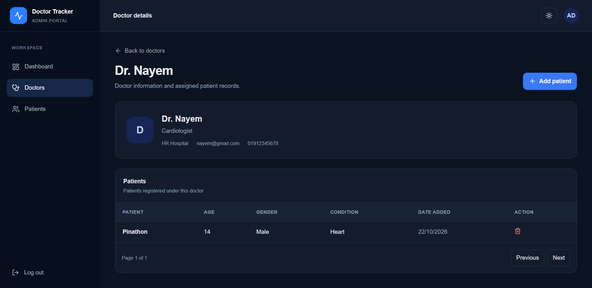

#### Patient management

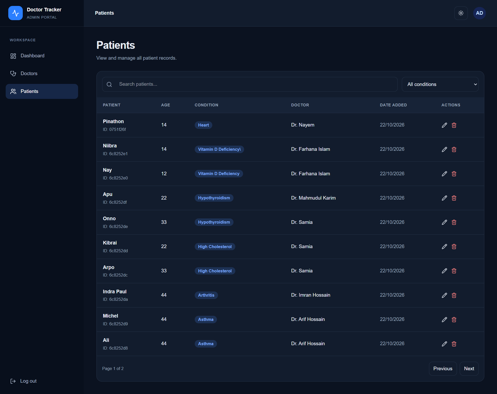

#### Admin login

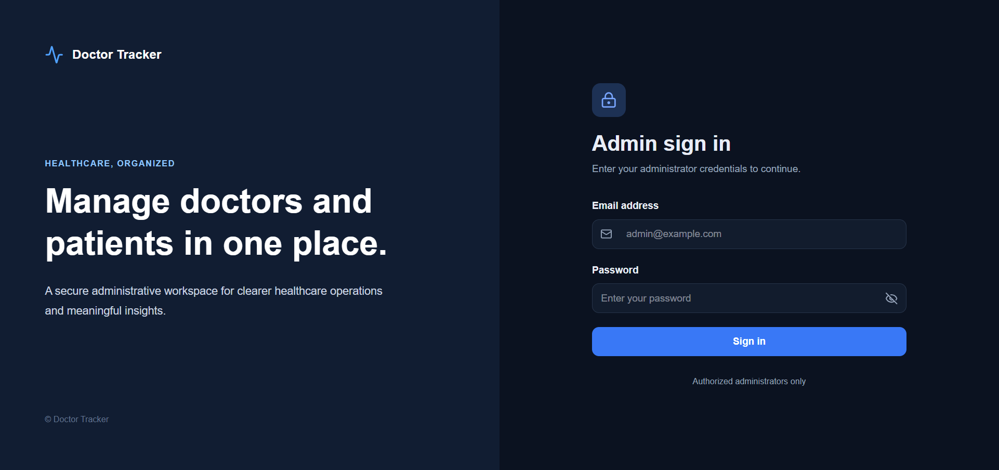

### Mobile

#### Dashboard

<p align="center">
  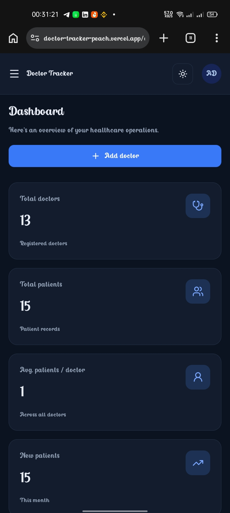
</p>

#### Doctor management

<p align="center">
  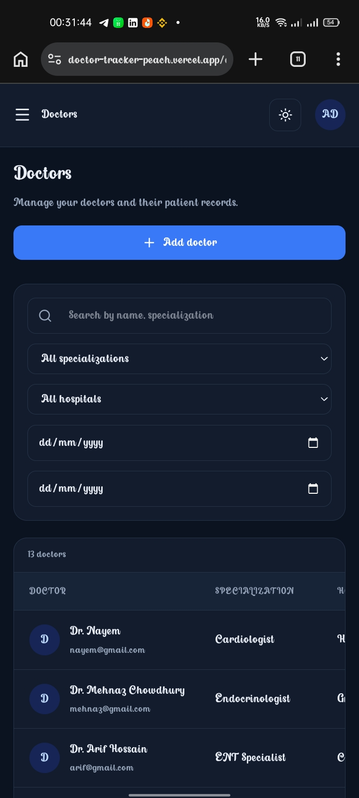
</p>

#### Doctor details

<p align="center">
  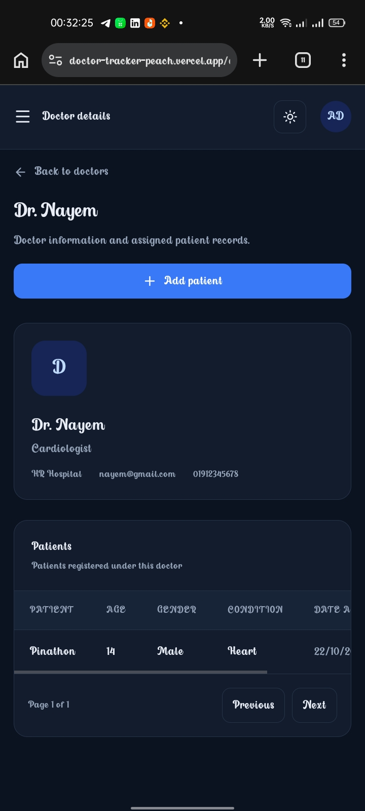
</p>

#### Patient management

<p align="center">
  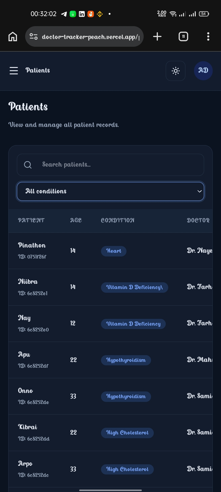
</p>

#### Admin login

<p align="center">
  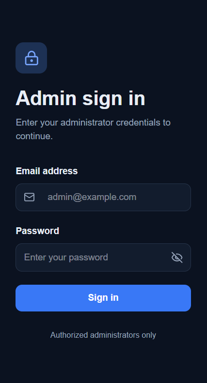
</p>

## Validation

Run frontend checks from `client/`:

```bash
npx tsc --noEmit
npm run lint
npm run build
```

There is no automated test script in the frontend package. Exercise the login, doctor, patient, filtering, pagination, and dashboard flows against a non-production database before deploying. The production build and TypeScript check have passed; ESLint currently reports existing issues, primarily `any` types and React/JSX lint rules.

## Security Notes

- Never commit `server/.env`, `client/.env`, or `client/.env.local`; use the checked-in `.env.example` files as templates.
- Replace example JWT secrets and admin credentials before seeding or deploying.
- Protect `GET /api/v1/patients` before using sensitive patient data; it is public in the current implementation.
- The frontend does not currently retry failed requests after refreshing an expired access token, so users may need to sign in again when the access token expires.
- Client-side redirects are for user experience, not authorization. Enforce access control in API middleware.
